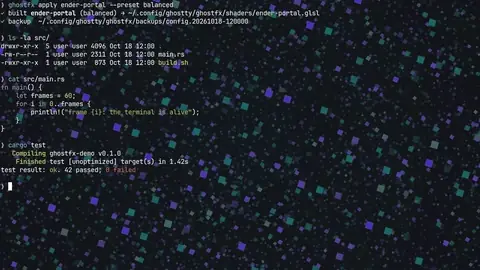
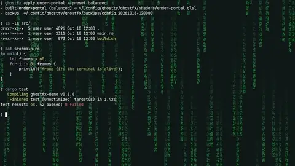
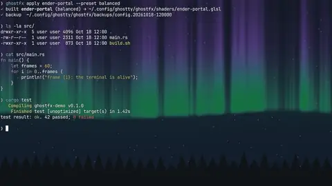

<div align="center">

# `ghost`fx

**Make your terminal another universe.**

253 original, animated GLSL shaders for the [Ghostty](https://ghostty.org) terminal,
with a CLI that installs them safely, a Home Manager module, and a live gallery.

[](https://github.com/r3dg0d/ghostfx/actions/workflows/ci.yml)
[](LICENSE)
[](https://github.com/r3dg0d/ghostfx/releases)

  

</div>

```sh
nix run github:r3dg0d/ghostfx -- apply ender-portal      # or: pipx install git+https://github.com/r3dg0d/ghostfx
```

## Why GhostFX

* **253 distinct shaders in 18 categories**: ocean, fire, particles, Minecraft-inspired, CRT,
  glitch, alien, space, glass, electricity, metal, cyberpunk, matrix, nature, liquid,
  geometric, portals and experimental. Every one is original procedural code, with no
  textures, and a test guards against near-duplicates.
* **Your text stays readable.** Background effects only paint where Ghostty draws its
  background colour, so glyphs and coloured cells sit on top untouched. A hue-preserving
  luminance cap and a halo keep contrast up. Contrast is measured for every shader.
* **Built for Ghostty's real pipeline.** Every shader goes through the same chain as
  Ghostty: glslang → SPIR-V → SPIRV-Cross GLSL 4.30 (Linux) and Metal MSL (macOS).
  Every shader has also been rendered in a real Ghostty 1.3.1 instance.
* **Safe installs.** GhostFX edits only a marked block in your config, writes atomically,
  backs up first and can roll back. It never deletes your own `custom-shader` lines, and
  it reloads Ghostty for you.
* **Tunable.** Subtle/balanced/cinematic presets, 12 palettes, eco/balanced/ultra quality
  profiles, plus per-shader parameters. Accessibility switches: reduced motion, reduced
  flashing, no text distortion and high readability.
* **Declarative on NixOS.** A Home Manager module compiles the shader into the Nix store.

## Install

| | |
|---|---|
| **Nix** | `nix run github:r3dg0d/ghostfx -- list` · `nix profile install github:r3dg0d/ghostfx` |
| **Home Manager** | see [below](#nixos--home-manager) |
| **pipx** (Linux/macOS) | `pipx install "git+https://github.com/r3dg0d/ghostfx"` |
| **single file** | download `ghostfx.pyz` from a release, then `python3 ghostfx.pyz list` |
| **no tooling** | copy `dist/<category>/<id>.glsl` and add `custom-shader = /path/to/it.glsl` |

Requires **Ghostty 1.3+**. Use `--legacy` builds for 1.2. Python ≥ 3.11 with no runtime
dependencies. Optional: `glslang` and `spirv-cross` for `ghostfx validate`, and
`moderngl numpy pillow` for offscreen previews and benchmarks.

## Quick start

```sh
ghostfx list                         # browse by category
ghostfx search purple portal         # fuzzy search
ghostfx info ender-portal            # parameters, presets, colours
ghostfx apply ender-portal           # build, install, edit config, reload Ghostty
ghostfx apply nebula --preset subtle --palette arctic-ice --quality eco
ghostfx apply matrix-rain --set intensity=0.4 --set primary=#00ff88
ghostfx tui                          # interactive browser (or just `ghostfx`)
ghostfx disable                      # remove the effect (backup kept)
ghostfx rollback                     # restore the previous config
```

Ghostty on Linux reloads automatically (GhostFX sends `SIGUSR2`). On macOS, press
**cmd+shift+,**.

## CLI

```
ghostfx list [--category C] [--tag T]       ghostfx favorites | favorite <id> [--remove]
ghostfx search <query>                       ghostfx random [--favorites] [--apply]
ghostfx info <id>                            ghostfx categories | palettes
ghostfx preview <id> [--window | --out x.png]
ghostfx install <id> [build options]         ghostfx preset list [id]
ghostfx apply <id> [build options]           ghostfx preset apply <id> <preset> | <user-preset>
ghostfx export <id> -o file.glsl             ghostfx preset create <name> --shader <id>
ghostfx current | disable [--restore]        ghostfx config show | edit | validate | path
ghostfx uninstall <id>                       ghostfx rollback [--list]
ghostfx validate [paths...]                  ghostfx benchmark <id...> | --all
ghostfx doctor | update | version            ghostfx tui
```

Build options: `--preset`, `--palette`, `--quality eco|balanced|ultra`, `--set key=value`,
`--reduced-motion`, `--reduced-flash`, `--high-readability`, `--no-distort`, `--legacy`,
`--colorspace auto|native|linear`. Global flags: `--json`, `--dry-run`, `--yes`, `--config PATH`.

If you already have your own `custom-shader` lines, `apply` stops and asks. `--replace`
comments them out in a way `disable --restore` can undo. `--chain` keeps them, and Ghostty
then runs both shaders.

## Presets and palettes

| Preset | Use |
|---|---|
| `subtle` | all-day coding: intensity 0.35, slower, maximum text protection, text never moves |
| `balanced` | the default |
| `cinematic` | screenshots and demos: full intensity, ultra quality |

Palettes: `cyberpunk-purple`, `matrix-green`, `electric-blue`, `inferno-red`,
`obsidian-black`, `midnight-ocean`, `synthwave-pink`, `gold-chrome`, `arctic-ice`,
`alien-emerald`, `retro-amber`, `neon-rainbow`.

Your own presets are TOML files (GhostFX's format, compiled into the shader; Ghostty itself
never reads them):

```toml
# ~/.config/ghostty/ghostfx/presets/my-portal.toml  ->  ghostfx preset apply my-portal
[shader]
name = "ender-portal"
base = "balanced"
intensity = 0.55
speed = 0.8
quality = "eco"
palette = "cyberpunk-purple"

[params]
depth = 1.4
```

## NixOS / Home Manager

```nix
# flake.nix
inputs.ghostfx.url = "github:r3dg0d/ghostfx";

# home.nix
imports = [ inputs.ghostfx.homeManagerModules.default ];
programs.ghostty.enable = true;
programs.ghostfx = {
  enable = true;
  shader = "ender-portal";
  preset = "balanced";            # subtle | balanced | cinematic
  palette = "cyberpunk-purple";   # optional
  quality = "eco";                # optional
  settings = { intensity = 0.5; };
};
```

The module builds the shader at evaluation time and adds it to
`programs.ghostty.settings.custom-shader`. Run `ghostfx` on such a system and it detects
the read-only, Home Manager-generated config, so it prints the Nix snippet instead of
editing anything. `nix build github:r3dg0d/ghostfx#shaders` gives you every shader with
every preset. See [`examples/`](examples) for NixOS, Home Manager and Hyprland setups.

## Categories

| | | |
|---|---|---|
| 🌊 Ocean & Water (14) | 🔥 Fire & Plasma (12) | ✨ Particles (16) |
| ⛏ Minecraft-Inspired (12) | 📺 CRT & Retro (21) | 👾 Glitch (15) |
| 👽 Alien & Sci-Fi (15) | 🌌 Space & Cosmos (23) | 🔮 Glass & Glossy (17) |
| ⚡ Electricity & Energy (18) | ⚙ Metallic & Industrial (15) | 🌆 Cyberpunk (13) |
| 💚 Matrix & Code (4) | 🌲 Nature & Atmosphere (19) | 🫧 Liquid Art (5) |
| 🔷 Geometric Art (11) | 🌀 Portals (7) | 🧪 Experimental (16) |

Browse them all, with live WebGL previews and parameter controls, in the gallery
(`website/`, deployed to GitHub Pages).

## Performance

Fragment shaders cost GPU time on every pixel of every frame. By default Ghostty animates
only while the window is focused (`custom-shader-animation = true`). Use `--quality eco`
on laptops.

`ghostfx benchmark <id> --sizes 1920x1080,2560x1440,3440x1440,3840x2160` measures GPU time
offscreen through the same GLSL that Ghostty's OpenGL renderer runs. The numbers in
[`docs/PERFORMANCE.md`](docs/PERFORMANCE.md) were measured on **software rendering**
(Mesa llvmpipe). They are useful for ranking shaders against each other, not as GPU frame
rates. No numbers from real GPUs (RTX 4090 or others) have been recorded yet; please
contribute some with `ghostfx benchmark --all --save results.json`.

## How it works

* `glsl/common/core.glsl`: the compatibility layer between GhostFX and Ghostty's real
  interface. It handles colour space (Ghostty passes linear colour when
  `alpha-blending = linear*`), text masking, readability, compositing modes and
  reduced-motion/flash handling.
* `docs/GHOSTTY_SHADER_API.md`: what Ghostty actually provides. For example, `iMouse` is
  always zero, there's no previous-frame feedback, and shaders that fail to compile are
  dropped silently. All of this was established from Ghostty's source and real runs.
* `docs/SHADER_FORMAT.md`: how to write a shader. `docs/ARCHITECTURE.md`: how the pieces
  fit together.

## Verification status

* All 253 shaders compile through Ghostty's pipeline: SPIR-V, GLSL 430, MSL, the legacy
  1.2 prefix, and GLSL ES 3.00 for the gallery. CI runs this on Linux and macOS.
* All 253 were rendered in **Ghostty 1.3.1 on Linux** (OpenGL via Mesa llvmpipe under
  Xvfb). Results, including animation and text-contrast checks, are in
  [`tests/verification.json`](tests/verification.json). Thumbnails come from those
  captures.
* **macOS/Metal**: the shaders cross-compile to MSL exactly as Ghostty does, but no run on
  real Mac hardware has been recorded yet.

See [`docs/IMPLEMENTATION_STATUS.md`](docs/IMPLEMENTATION_STATUS.md) for the full picture.

## Contributing

New shaders are welcome. Read [CONTRIBUTING.md](CONTRIBUTING.md), then:

```sh
nix develop            # or: pip install -e ".[dev,preview]" + glslang + spirv-cross
$EDITOR shaders/space/my-shader.glsl
python3 -m ghostfx validate shaders/space/my-shader.glsl
python3 -m ghostfx preview my-shader --window
pytest -q
```

## Roadmap

* Benchmarks on real GPUs (RTX 4090 at 3440×1440 is the primary target) and Apple Silicon
* Runtime verification on macOS (Metal)
* Animated previews for every shader in the gallery
* More cursor-reactive shaders (Ghostty exposes cursor position, colour and change time)

## License

MIT for all code and shaders. See [LICENSE](LICENSE) and
[THIRD_PARTY_NOTICES.md](THIRD_PARTY_NOTICES.md). Minecraft-inspired shaders are original
procedural interpretations with no game assets. GhostFX is a community project, not
affiliated with Ghostty or Mojang.
